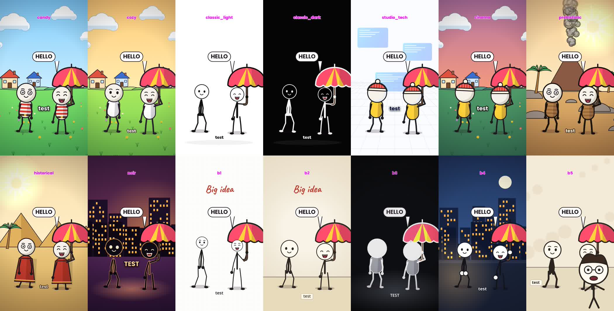
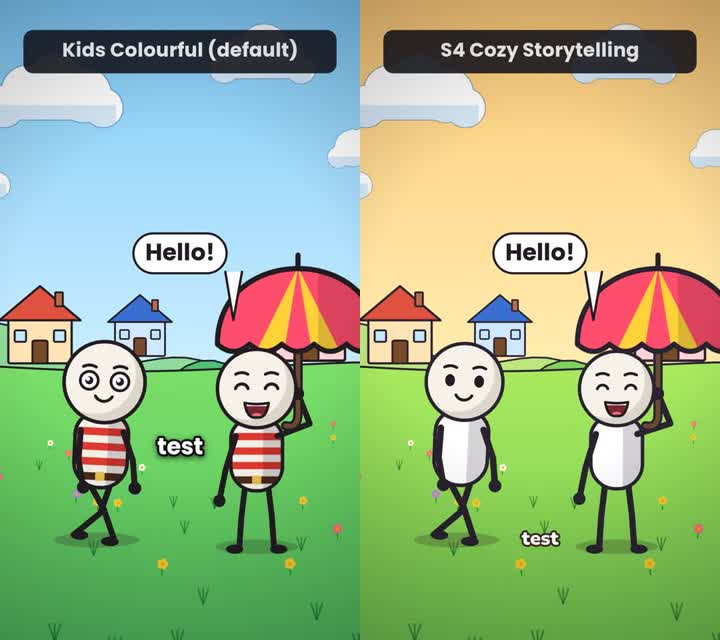
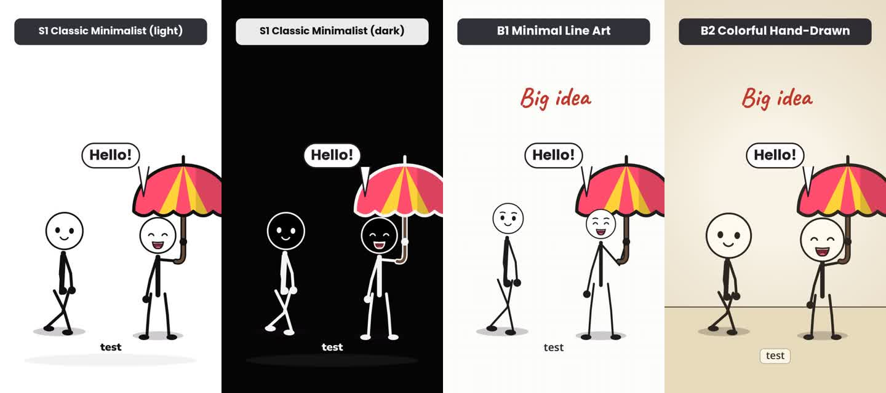
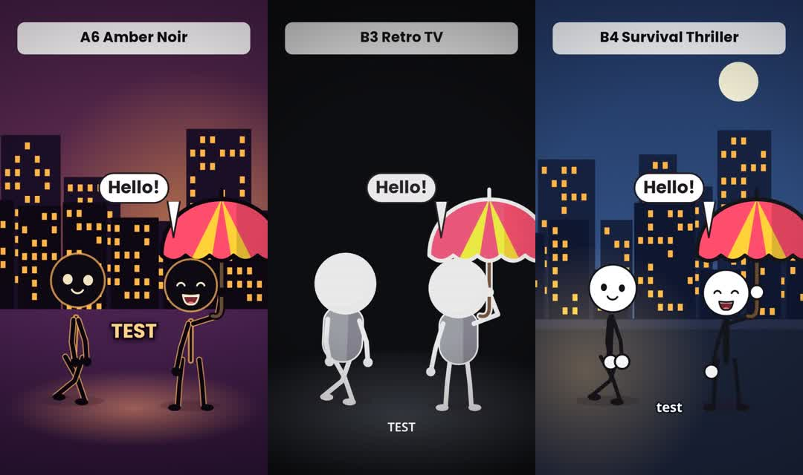
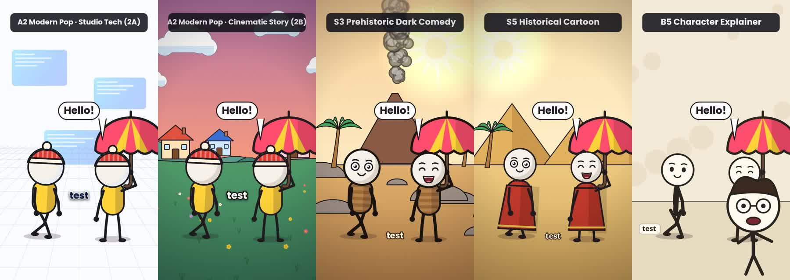
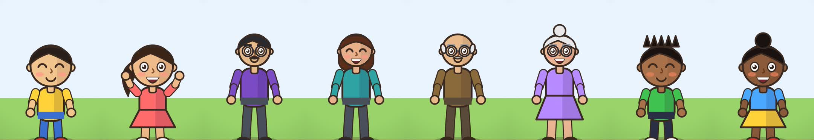
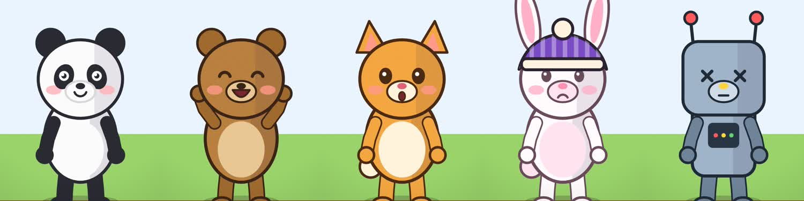
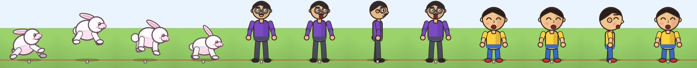
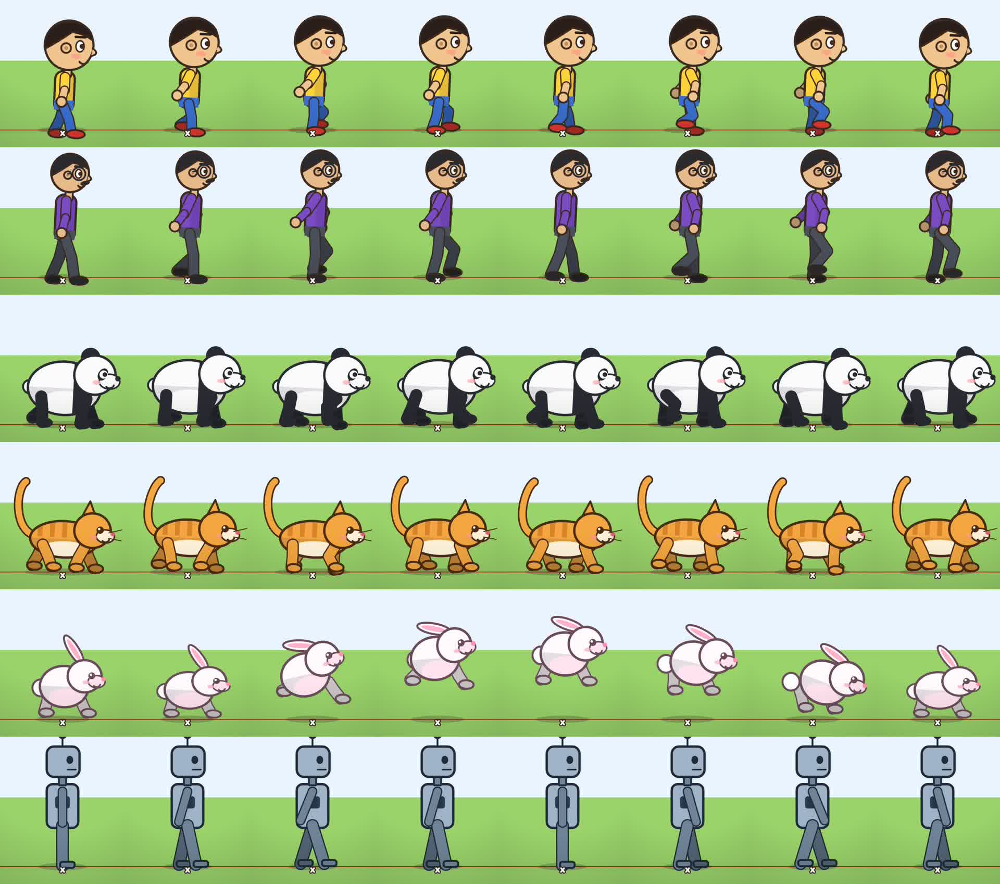

# Jatin's Stickman Skill

Type **`/stickman`** in Claude Code and get a finished **9:16 stick-figure video** (about 35-55 s) with voiceover, captions, music and sound effects. Everything is drawn by code, so it is free to render and fully repeatable.



## What you get
- **15 looks (modes):** Kids/Candy, Cozy, Classic light/dark/grey, Modern Pop (Studio Tech / Cinematic), Prehistoric, Historical (Egypt/Rome/Castle), Amber Noir, B1 Line Art, B2 Hand-Drawn, B3 Retro TV, B4 Survival Thriller, B5 Character Explainer.
- **Cast types:** stick figures, human figures, animal figures (panda, bear, cat, bunny, robot), or mixed (humans and animals as separate characters).
- **Real movement:** planted-foot walk cycles, front / 3-quarter / side views chosen per beat, animals with their own gaits (bunny hops, cat trots...).
- **Languages:** English or Hindi voice (any edge-tts voice works), and optional **English captions over a Hindi voice**.
- **Two-character dialogue** with two voice pitches.
- **Story help:** 4 story pitches, or recreate a reference video in your own words, or expand your own idea.
- The skill asks you **mode -> language -> cast -> story**, then builds, renders and shows you the video.

| Kids / cozy | Minimal line | Dark & cinematic | Modern & story worlds |
|---|---|---|---|
|  |  |  |  |

Cast types: humans  animals 

Views and walks:  

## Install (3 steps)
**You need:** [Claude Code](https://claude.com/claude-code), Node.js 18+, Python 3.9+, ffmpeg.
(Linux/macOS/WSL. On Windows use WSL.)

```bash
git clone https://github.com/mohanappmontize/jatins-stickman-skill.git
bash jatins-stickman-skill/install.sh
```

The installer copies the skill to `~/.claude/skills/stickman`, creates `~/.stickman` (Python venv with edge-tts/numpy/scipy, Playwright + Chromium) and runs a self-check. Restart Claude Code, then type:

```
/stickman
```

Check the setup any time with `bash ~/.stickman/doctor.sh`.

## How it works
1. `/stickman` shows sample pictures of the looks and asks: look, language, cast, story.
2. It writes the script (`script.json`), generates the voice with edge-tts, and builds the shots in code (`shots.js`).
3. It renders stills first, checks one contact sheet for problems (cut-off characters, overlaps), then renders the video with Playwright + ffmpeg and mixes voice, music and SFX.
4. Output lands in `~/stickman_projects/<name>/`.

## Examples
- `examples/doubt_hindi/` - two-character gag in Hindi with English captions ([video](examples/doubt_hindi/doubt_hindi_share.mp4)).
- `examples/password_race/` - Hindi chase story with a human, a bunny and a runaway locked tablet ([video](examples/password_race/password_race_share.mp4)).
Each folder has the full `script.json`, `shots.js` and `audio.py` so you can see exactly what the skill produces.

## Repo layout
```
skills/stickman/     the skill (SKILL.md, engine/, references/, thumbs/, install.sh, doctor.sh)
examples/            two finished projects
install.sh           one-command installer
.claude-plugin/      plugin manifest (optional install path)
```

## Troubleshooting
- `FAIL playwright/chromium`: run `bash ~/.claude/skills/stickman/install.sh` again.
- Hindi text looks like boxes: fonts are bundled in `engine/web/fonts`; make sure you did not delete them.
- Render is slow: set `WORKERS=4` before `./make.sh` on small machines.

## Credits
Built by Jatin. Story-shape ideas learned from popular stick-figure animation shorts; all code and art here are original. MIT licensed.
